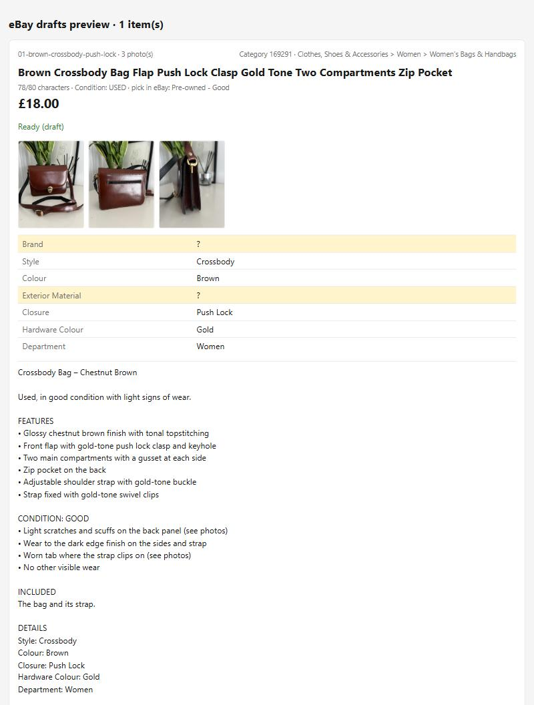

# eBay Lister

[](https://github.com/kalinzstoev/kalinstoev-skills/actions/workflows/tests.yml)

A [Claude Code](https://claude.com/claude-code) skill that turns phone photos of things you
want to sell into eBay draft listings.



*A real item, written from three phone photos: the push-lock clasp, the two compartments, the
zip pocket and the scuffs on the back. The photos don't show the brand or material, so those
rows are highlighted and Claude asks you about them.*

You drop photos in a folder. Claude sorts them into items, reads what each photo shows (labels,
material, pockets, wear) and writes a title, features, a condition report and a price. You
check a preview, upload one CSV in Seller Hub, then add photos and publish each draft in eBay.
eBay already suggests categories and item specifics; describing the item from your photos is
the part it can't do.

It suits a dozen items at a time, with no database or accounts to set up. This repository is
`kalinstoev-skills`, a Claude Code plugin for my skills, and `ebaylister` is the first of them.

## What to expect

- Claude only states what the photos show or what you tell it. No "genuine", "works
  perfectly" or "waterproof" from guesswork.
- Nothing touches your eBay account. There are no eBay API calls, keys or logins, and no
  other API keys either: Claude Code does the work on your existing subscription. The output
  is a CSV you upload yourself, and the script refuses to write any row that isn't a draft.
- eBay's draft upload carries the title, description, price and category, but not photos,
  condition, item specifics or postage. You set those in the eBay app from a tick-list, a few
  minutes per item. See [what carries into the draft](skills/ebaylister/README.md#what-carries-into-the-draft).
- Claude reads your photos as part of your conversation. The plugin sends nothing anywhere;
  its files stay in the folder you run it in (`inbox/`, `items/`, `out/`) until you delete
  them.
- It is tested on eBay UK only ([other sites](#other-ebay-sites)), and in Claude Code (the
  terminal or the desktop app's Code tab), not in Claude chat or Cowork.

## What you need

- [Claude Code](https://claude.com/claude-code). If you don't use a terminal, use the Claude
  desktop app.
- [Python 3](https://www.python.org/downloads/). On Windows, tick "Add python.exe to PATH" in
  the installer.
- An eBay seller account with Seller Hub.

## Install

In Claude Code, run:

```
/plugin install kalinstoev-skills --marketplace kalinzstoev/kalinstoev-skills
```

If your Claude Code doesn't recognise that, use:

```
/plugin marketplace add kalinzstoev/kalinstoev-skills
/plugin install kalinstoev-skills@kalinzstoev
```

Choose "Install for you". The skill then works in every folder. There are
[other ways to install](#other-ways-to-install) too.

## Use

1. Make a folder for your selling, for example `Documents/ebay`, open it in Claude Code and
   type:

   ```
   /kalinstoev-skills:ebaylister
   ```

   or say "help me list some things on eBay". Claude creates an `inbox` folder and tells you
   where it is.

2. Copy your photos into it (a Google Photos zip works) and tell Claude. Take several photos
   of each item, one item after another, including labels and damage.

3. Claude shows how it grouped the photos, opens a preview in your browser and asks what the
   photos can't tell it, such as size or whether it works. Ask for changes in plain words:
   "it's a size 10", "drop the blurry photo", "price it at 20".

4. Say which items you approve. Claude writes the CSV and a tick-list and tells you where they
   are.

5. In Seller Hub, go to Reports → Uploads → Upload template and upload the CSV. Don't open it
   in Excel first.

6. Finish each draft in the eBay app from the tick-list: add photos, pick the condition, check
   eBay's suggestions, publish.

You don't type commands or edit files yourself. The [skill's README](skills/ebaylister/README.md)
has the full walkthrough.

## Other eBay sites

The CSV is written for eBay UK in pounds by default. For another site, download its drafts
template (Seller Hub → Reports → Uploads → Get template → Listings → "Create drafts template")
and save it unchanged as `ebay-template.csv` in the folder you run Claude Code in. The skill
copies that template's header, the preview uses your currency, and Claude picks categories for
that site.

Nobody has tried this outside the UK yet, so upload one draft first. Please open an issue to
say whether it worked for your site.

## Changing how listings are written

The rules for titles, descriptions and prices are plain text in
[`skills/ebaylister/SKILL.md`](skills/ebaylister/SKILL.md). Edit that file, or tell Claude
what you want during a run.

## Other ways to install

From your shell:

```bash
claude plugin marketplace add kalinzstoev/kalinstoev-skills
```

```bash
claude plugin install kalinstoev-skills@kalinzstoev
```

As a plain skill with the [skills CLI](https://github.com/vercel-labs/skills) (needs Node),
called `/ebaylister`:

```bash
npx skills add kalinzstoev/kalinstoev-skills
```

By hand: download the repository (Code → Download ZIP) and copy `skills/ebaylister` into
`~/.claude/skills/` (Windows: `%USERPROFILE%\.claude\skills\`). It is then called
`/ebaylister`.

## How it is built

- Claude does the judgement and a script does the exact work. Reading photos and writing
  listings is in `SKILL.md` as instructions. Title lengths and a CSV eBay accepts byte for
  byte are in `ebay_lister.py` (Python standard library only), with tests.
- The tool can't reach eBay: no API, keys or login. The script only writes `Draft` rows and a
  test checks it refuses anything else, so the worst a mistake can do is create a draft you
  delete.
- The first design used eBay's APIs. Research into eBay's docs and a test upload showed the drafts CSV was enough and that eBay ignores item specifics in
  it, so the API was dropped and specifics go in the description and tick-list.
- Besides unit tests, a fresh Claude with no knowledge of the project ran the skill on real
  photos from a clean copy. It wrote "waterproof" from brand knowledge, which led to the rule
  that only what the photos show may be stated.
- Other eBay sites use eBay's own template for that site, so no header values are guessed in
  code.

One person built it with Claude Code for a real clear-out and listed nine items with it before
making it public.

## Project layout

```
skills/ebaylister/            the skill: SKILL.md, ebay_lister.py, tests, README
.claude-plugin/               plugin and marketplace manifests, for /plugin install
.github/workflows/tests.yml   runs the tests on Linux, Windows and macOS
```

## Working on it

Load your checkout as a plugin for one session:

```bash
claude --plugin-dir .
```

Run the tests from the skill folder (`python` instead of `python3` on Windows):

```bash
cd skills/ebaylister && python3 -m unittest test_ebay_lister.py
```

## Licence

[MIT](LICENSE). Not affiliated with or endorsed by eBay.
